<div align="center">

# Factory Skills

**Make your coding agent write code like your best senior engineer.**

Reusable skills for Claude Code, Codex, and other AI coding agents. They make the agent read your codebase before it writes, reuse what already exists, follow your conventions, and prove its work with real checks.



</div>

## Quick start

Install a skill into your project:

```bash
npx skills add akdevsaha-dev/factory-skills --skill implement-feature
```

Then ask your agent for something:

```text
/implement-feature add a fallback to the fetching views
```

That's it. The agent finds the views, reuses your existing components, matches your code style, runs your checks, and tells you what it verified.

## Skills

| Skill | What it does | Type this |
| --- | --- | --- |
| [`implement-feature`](skills/implement-feature/SKILL.md) | Builds a feature in an existing codebase the way a senior engineer would | `/implement-feature add CSV export to invoices` |
| [`init-backend`](skills/init-backend/SKILL.md) | Scaffolds a clean backend: Node.js + TypeScript, Python + FastAPI, or Go | `/init-backend` |
| [`init-database`](skills/init-database/SKILL.md) | Connects your backend to Postgres with Prisma, Drizzle, or Supabase | `/init-database` |
| [`init-auth`](skills/init-auth/SKILL.md) | Adds authentication and authorization with Supabase Auth, Clerk, or Better Auth | `/init-auth` |
| [`catch-up`](skills/catch-up/SKILL.md) | Explains what teammates changed since your last commit, grouped by feature, and what affects your work | `/catch-up` |

### implement-feature

Ask for a feature in plain words. Before writing anything, the agent finds the code your request refers to and the existing feature most like it, then reuses your components, helpers, and patterns. It adds meaningful tests, runs your linter, type checker, and test suite, and reviews its own diff. No narrating comments, no new abstractions you didn't need.

```bash
npx skills add akdevsaha-dev/factory-skills --skill implement-feature
```

### init-backend

A production-oriented backend with routes, handlers, services, validation, config, tests, and a health endpoint on port 8080. You pick Node.js + TypeScript + Express, Python + FastAPI + uv, or Go with the standard library.

```bash
npx skills add akdevsaha-dev/factory-skills --skill init-backend
```

### init-database

Wires an existing backend to your database: one client, validated config, and `.env` files. It creates no tables, so your schema stays yours.

```bash
npx skills add akdevsaha-dev/factory-skills --skill init-database
```

### init-auth

Inspects your stack, recommends Supabase Auth, Clerk, or Better Auth with reasons, and implements email OTP, social login, magic links, or passkeys. Every route is checked on the server, and adversarial tests (IDOR, privilege escalation, open redirects, OTP reuse) prove it.

```bash
npx skills add akdevsaha-dev/factory-skills --skill init-auth
```

### catch-up

Back from a break, or about to pull? The agent finds your last commit, reads the actual diffs and the code around them, and briefs you by feature: API and schema changes, migrations, dependencies, removed code, conflicts with your local work, and risks worth reviewing, each with file and line. It never fetches, pulls, or touches your working tree. Add `deep` for a full review, `remote` to see what a pull would bring in, or start from `since <ref or date>`, `last <N>`, `checkpoint`, or `author <name>`.

```bash
npx skills add akdevsaha-dev/factory-skills --skill catch-up
```

## Install options

**Every skill at once**

```bash
npx skills add akdevsaha-dev/factory-skills --skill '*'
```

**A specific agent**

```bash
npx skills add akdevsaha-dev/factory-skills --skill implement-feature -a claude-code
npx skills add akdevsaha-dev/factory-skills --skill implement-feature -a codex
```

**Globally, for all your projects**

```bash
npx skills add akdevsaha-dev/factory-skills --skill implement-feature -g
```

**See what's available**

```bash
npx skills add akdevsaha-dev/factory-skills --list
```

## From empty folder to shipped feature

The skills work on their own and chain together. When an init skill needs something that doesn't exist yet, such as a backend or a database, it offers to set it up first.

```text
/init-backend          →  backend/ with routes, services, tests, and /health
/init-database         →  a Postgres client wired into your config
/init-auth             →  sign-in, sessions, roles, and server-side checks
/implement-feature …   →  every feature after that, in the same style
```

You can also skip the slash command and ask in plain words: *"Use the init-auth skill to add Google sign-in."*

## How the skills think

- **Read before writing.** The agent finds similar code and traces how it works before changing anything.
- **Your codebase wins.** Your conventions, folder structure, and `AGENTS.md` or `CLAUDE.md` override any default.
- **Reuse before creating.** Existing helpers, components, and patterns come first. New abstractions need a reason.
- **Code that explains itself.** Clear names and simple control flow. Comments say why, never what.
- **Current docs, not memory.** Versions, APIs, and prices are looked up from official sources, not baked into the skill.
- **Evidence, not claims.** A check counts only if it ran and passed. Anything unverified is reported as unverified.

## Contributing

Each skill is installed on its own, so it cannot read files from another skill. Shared standards live once in `shared/` and are copied into every skill that ships them. Edit the file in `shared/`, then run `scripts/sync-shared.sh`; `scripts/sync-shared.sh --check` fails if any copy is out of date.

`assets/demo.svg` is hand-built. Keep it to real behavior the skills have shown.

## License

[MIT](LICENSE)
